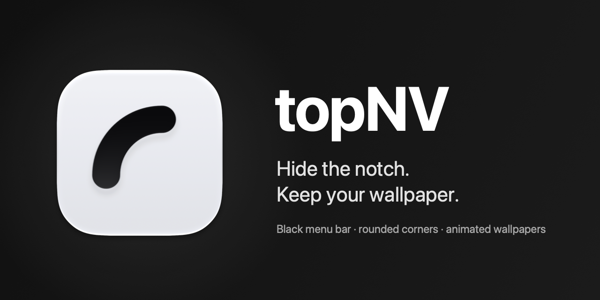

<div align="center">
  
  <h1>TopNV</h1>
  <p>Blend the MacBook notch into a black menu bar and give your display rounded corners.</p>
  <p>
    <a href="https://github.com/bernalli/topNV/releases/latest"></a>
    
  </p>
</div>

## Download

**[Download the latest release](https://github.com/bernalli/topNV/releases/latest)** · macOS 14 or later

Open `TopNV-<version>.dmg` and drag **TopNV** into **Applications**.

TopNV is signed ad hoc, not notarized. On first launch, right-click the app in
Applications and choose **Open**, then confirm. If macOS blocks it, allow it in
**System Settings > Privacy & Security**.

## Features

- Hide the notch against a black menu-bar strip on notched displays.
- Round the corners of the built-in display, or enable corners on all displays.
- Choose a corner radius of 5, 10, 15, 20, 25 or 30 points.
- Keep your wallpaper untouched, including dynamic and animated wallpapers.
- Launch at login and optionally hide the menu-bar icon while the app keeps running.

There is no Dock icon. No Screen Recording or Accessibility permission is required.
Hide Notch and Round Corners start enabled, with a 15-point radius on the built-in display.
Your choices are saved automatically.

## Menu

Click the menu-bar icon to see the current configuration and change it directly.

| Item | What it does |
| --- | --- |
| Hide Notch | Turn the black menu-bar strip on or off. |
| Round Corners | Turn corner overlays on or off. |
| Corner Radius | Select a preset. A stored non-preset value remains selected as **Custom**, without rounding it to a preset. |
| Details | Show the stored radius, selected display scope and system requirements; open the source, release notes or issue tracker. |
| Options | Set **Corners on All Displays**, **Launch at Login** and **Hide Menu Bar Icon**. |
| Version / About TopNV | Show the installed version and the About window with a Buy Me a Coffee button. |
| Quit TopNV · ⌘Q | Stop the app and remove its overlays. |

Corner Radius and Corners on All Displays are disabled while Round Corners is off.
If Launch at Login needs approval, Options tells you to allow it in
**System Settings > General > Login Items**; registration errors appear there too.

To restore a hidden menu-bar icon, **open TopNV again from Applications**.

## How it works

TopNV places a black, click-through window behind the menu bar on each notched display.
The system menu bar draws above it, keeping its items readable and clickable.
It neither reads nor changes the wallpaper.

Four small click-through overlays create the rounded corners. They sit above the Dock
and ordinary windows, below pop-up menus. The overlays update when settings, displays
or Spaces change, and after wake from sleep.

## Limitations

- The black menu-bar strip applies only to displays with a notch. Other displays keep
  their normal menu bar.
- The desktop-level black strip is covered in full-screen apps; macOS handles their
  notch area itself.
- With an automatically hidden menu bar, the black strip covers only the notch-height
  area at the top of the screen.
- Rounded corners hide a few points of content at the very corners of the display.
- The app is signed ad hoc, not notarized, so macOS may require confirmation on first launch.

## Build from source

Install Xcode 16 or later with its macOS SDK and command-line tools selected, then run:

```sh
git clone https://github.com/bernalli/topNV.git
cd topNV
scripts/bundle.sh
open build/TopNV.app
```

The script builds the release executable, assembles `build/TopNV.app` and signs it ad hoc.
Move the app to Applications to keep it installed. To bundle an existing executable,
set `TOPNV_EXECUTABLE` to its path when running the script.

Run the tests with:

```sh
swift test
```

## Releases

[Release notes and downloads](https://github.com/bernalli/topNV/releases) are on GitHub.
The release workflow tests the code, builds a universal app for Apple silicon and Intel,
and publishes a versioned DMG. It runs on a `v*` tag or through **Actions > Release >
Run workflow** with a version number.

For a local disk image, run `scripts/make-dmg.sh` after `scripts/bundle.sh`;
the result is `build/TopNV.dmg`.

## Support

If TopNV is useful to you, you can [buy me a coffee](https://github.com/sponsors/bernalli).

## Author

Created by Samuele Martinalli.

Copyright (c) 2026 Samuele Martinalli. All rights reserved.
