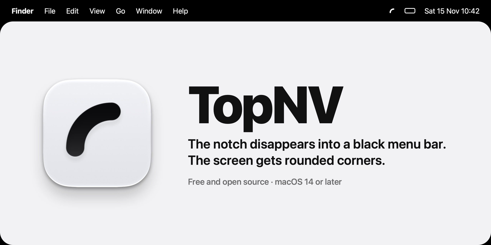

TopNV is a menu bar app for Mac. It hides the MacBook notch inside a black menu bar and rounds the corners of the screen.

## Why

On a MacBook with a notch, the menu bar takes its colour from the wallpaper and the notch shows as a black cut-out in the middle of it. TopNV places a black band behind the menu bar, so the bar and the notch look like one strip. Under a black bar the desktop starts with square corners, so TopNV also rounds the four corners of the screen to match. It never reads or changes the wallpaper.

## Download

1. Download the disk image from the [latest release](https://github.com/bernalli/TopNV/releases/latest).
2. Open it and drag TopNV into Applications.
3. Open TopNV.

TopNV is signed with a Developer ID and notarized by Apple. On first launch it asks whether to check for updates automatically, once a day. You can change this later in Options › Check for Updates Automatically. An update is installed only when you choose Install and Relaunch.

## Use

TopNV has no Dock icon. Click its icon in the menu bar. Hide Notch and Round Corners are on from the first launch.

- **Hide Notch** puts the black band behind the menu bar on a display with a notch.
- **Round Corners** rounds the four corners of the built-in display. The radius is fixed.
- **Options › Round Corners on All Displays** rounds the corners of external displays too.
- **Options › Launch at Login** starts TopNV when you log in.
- **Options › Hide Menu Bar Icon** hides the icon while TopNV keeps running. Open TopNV again to bring it back.
- **Check for Updates…** looks for a new version at any time.

The menu follows the system language: English, Italian, Spanish, French, German, Portuguese (Brazil), Japanese and Simplified Chinese.

## Requirements

- macOS 14 or later, on Apple silicon or Intel.
- A display with a notch for Hide Notch. Round Corners works on any display.
- No special permission. TopNV does not ask for Screen Recording or Accessibility access.

## License

TopNV is released under the [MIT License](LICENSE). Copyright © 2026 Samuele Martinalli.

TopNV includes [Sparkle](Licenses/Sparkle.txt) and the [Plus Jakarta Sans](Assets/Fonts/PlusJakartaSans-OFL.txt) font, each under its own license.

## Support

If TopNV is useful to you, you can [buy me a coffee](https://github.com/sponsors/bernalli).
